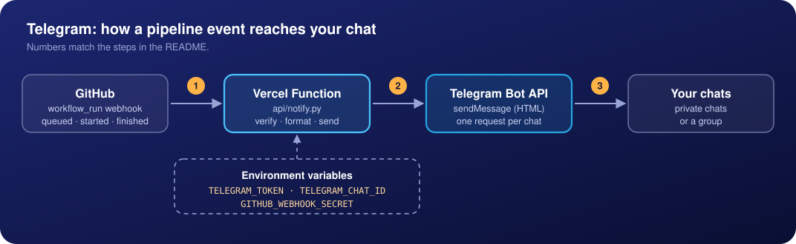
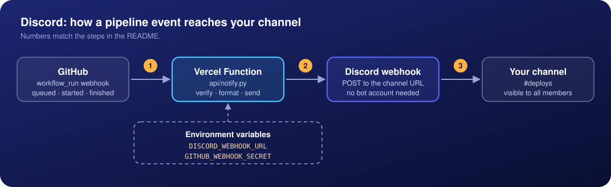

<p align="center">
  
</p>

<p align="center">
  
  
  
  
  
</p>

# GitHubActionsBot

Get a message in **Telegram** and/or **Discord** when a GitHub Actions pipeline is queued, starts running and finishes (with the result and the run time).

It is one small Python function that runs on Vercel. GitHub calls it through a webhook, so there is no server to maintain and nothing to add to your workflow files.

- **Three stages per run:** queued, in progress, finished (success, failure, cancelled and so on).
- **Telegram, Discord, or both.** Several Telegram recipients are supported.
- **No dependencies.** Python standard library only, no `requirements.txt`.
- **Works for every workflow** in a repository (or a whole organization) without touching the workflows.
- **Secure by default.** Every request is verified with GitHub's HMAC signature, secrets live in environment variables.

## Example message

```
✅ you/your-repo

⚙️ Workflow: Deploy to PROD

👤 User: you
🌿 Branch: main
📊 Status: Success
⏱️ Duration: 4 min 48 s

https://github.com/you/your-repo/actions/runs/123456789
```

The repository name and the workflow name are shown in bold. The icon in the title follows the status:

| Icon | Status |
| --- | --- |
| ⏳ | Queued |
| 🚀 | In progress |
| ✅ | Success |
| ❌ | Failure |
| 🚫 | Cancelled |
| ⏰ | Timed out |
| ⚠️ | Any other result (for example Skipped) |

The duration is added to the final message only.

## How it works

### Telegram

<p align="center">
  
</p>

1. **GitHub → function.** When a workflow run is queued, starts, or finishes, GitHub sends a signed `workflow_run` webhook to `/api/notify`.
2. **Function → Telegram.** The function checks the signature, ignores everything that is not one of the three events, builds the message and calls `sendMessage` once for every chat id in `TELEGRAM_CHAT_ID`.
3. **Telegram → you.** Telegram delivers the message to each private chat or group.

### Discord

<p align="center">
  
</p>

1. **GitHub → function.** Same signed `workflow_run` webhook as above.
2. **Function → Discord.** The function builds the message in Discord formatting and posts it to the channel webhook URL. No bot account is needed.
3. **Discord → everyone.** The message appears in the channel, so every member who can see the channel sees it.

You can use both at once: set the variables for both and each run is sent to Telegram and to Discord independently. If one of them fails, the other still gets the message.

## Requirements

- A GitHub repository whose pipelines you want to watch (admin access to add a webhook).
- A [Vercel](https://vercel.com) account. The free Hobby plan is enough, but it is limited to personal, non-commercial use. Check Vercel's terms before using it for company projects.
- A Telegram account and/or a Discord server where you can manage webhooks.

## Deployment

Do steps 1, 2, 5, 6 and 7 always, and step 3 and/or 4 depending on where you want the messages.

### 1. Get the code

Fork this repository, or clone it and push it to your own GitHub account:

```bash
git clone https://github.com/alekseigrindev/GitHubActionsBot.git
cd GitHubActionsBot
```

### 2. Deploy to Vercel

**Option A: import from GitHub (recommended).** Open [vercel.com/new](https://vercel.com/new), pick your copy of the repository, leave **Framework Preset** on *Other* and click **Deploy**. Pushes to the repository then deploy automatically.

If the repository is missing from the list, open **Configure GitHub App** on that page (or GitHub → *Settings* → *Applications* → *Vercel* → *Configure*) and give the app access to the repository.

**Option B: from your computer.**

```bash
npx vercel login
npx vercel          # first run: creates and links the project
npx vercel --prod   # production deployment
```

Vercel picks up `api/notify.py` automatically because Python files in `api/` become functions. When the deployment is finished, open

```
https://<your-project>.vercel.app/api/notify
```

in a browser. You should see `deploy-notify is up`. Use the **production domain** of the project (the short `<project>.vercel.app` one), not the long per-deployment URL: Vercel's Deployment Protection can block the per-deployment URLs, and GitHub cannot sign in to Vercel.

### 3. Connect Telegram

**Create the bot**

1. In Telegram open [@BotFather](https://t.me/BotFather) and send `/newbot`. Choose a name and a username that ends with `bot`.
2. BotFather replies with a token like `123456:ABC-DEF...`. This is the bot's password. It goes into `TELEGRAM_TOKEN` and nowhere else.
3. Optional: send `/setuserpic`, choose the bot and upload [`docs/img/logo.png`](docs/img/logo.png) as its picture.

**Find the chat id**

1. Open your bot in Telegram, press **Start** and send any message.
2. Open `https://api.telegram.org/bot<TOKEN>/getUpdates` in a browser (put your token in place of `<TOKEN>`).
3. Find `"chat":{"id": ...}` in the response. That number is your chat id. An empty `"result": []` means the bot has not received a message yet: write to it again and refresh.

> The `getUpdates` address contains your token. Do not paste the page or the address into chats, issues or screenshots.

For a **group**, add the bot to the group, send a message there and read the id the same way. Group ids are negative, for example `-1001234567890`; keep the minus sign.

**Several recipients.** Put all ids into `TELEGRAM_CHAT_ID` separated by `;`:

```
245283507;111111111;-1001234567890
```

Every person has to open the bot and press **Start** once. Telegram does not let a bot write first to someone who has not started it, and that recipient is skipped (the others still get the message). If everyone is in one team, a group with the bot is simpler: one id for everybody.

If the token ever leaks, send `/revoke` to BotFather to get a new one.

### 4. Connect Discord

1. Create a Discord server (the **+** button in the app), or use an existing one.
2. Create a text channel, for example `#deploys`. For a private channel, enable **Private Channel** in its settings and give access to the people or the role that should see it.
3. Open the channel settings (gear icon) → **Integrations** → **Webhooks** → **New Webhook**. You need the *Manage Webhooks* permission.
4. Give it a name, optionally upload [`docs/img/logo.png`](docs/img/logo.png) as the avatar, and click **Copy Webhook URL**.
5. The copied URL goes into `DISCORD_WEBHOOK_URL`.

Good to know:

- One webhook URL belongs to one channel. Everyone who can see the channel sees the messages, so invite your teammates to the server (right-click the server → *Invite People*).
- Each person chooses whether the channel makes a sound or a push notification (right-click the channel → *Notification Settings*).
- The bot never pings anyone: `@everyone`, `@here` and user mentions are disabled, even if a branch name contains them.
- Anyone who has the webhook URL can post to your channel. Treat it like a password.

### 5. Set the environment variables

In Vercel open your project → **Settings** → **Environment Variables** and add the variables you need (make sure *Production* is ticked):

| Variable | Required | Value |
| --- | --- | --- |
| `GITHUB_WEBHOOK_SECRET` | yes | A long random string you make up, for example the output of `openssl rand -hex 32`. The same string goes into the GitHub webhook in step 6. |
| `TELEGRAM_TOKEN` | for Telegram | Bot token from BotFather. |
| `TELEGRAM_CHAT_ID` | for Telegram | One chat id, or several separated by `;`. |
| `DISCORD_WEBHOOK_URL` | for Discord | The channel webhook URL. |

Telegram is skipped when `TELEGRAM_TOKEN` is not set, and Discord is skipped when `DISCORD_WEBHOOK_URL` is not set, so you can use either one alone.

**Variables only apply to new deployments.** After adding or changing them, redeploy (Vercel → *Deployments* → *Redeploy*, or `npx vercel --prod`).

### 6. Add the webhook in GitHub

In the repository whose pipelines you want to watch open **Settings** → **Webhooks** → **Add webhook**:

| Field | Value |
| --- | --- |
| Payload URL | `https://<your-project>.vercel.app/api/notify` |
| Content type | `application/json` |
| Secret | The same value as `GITHUB_WEBHOOK_SECRET` |
| Which events? | **Let me select individual events** → tick only **Workflow runs** |
| Active | ticked |

Click **Add webhook**. GitHub immediately sends a `ping`; open the webhook → **Recent Deliveries** and check that the response is `200`. The function accepts the ping and sends nothing to your chat.

To watch every repository of an organization at once, add the same webhook in the organization settings instead.

### 7. Test it

**Send a test message by hand.** This signs a sample payload the same way GitHub does and sends a real message to your chat. Fill in the first two lines:

```bash
URL=https://<your-project>.vercel.app/api/notify
SECRET='<your GITHUB_WEBHOOK_SECRET>'

BODY='{"action":"completed","repository":{"full_name":"you/repo"},"workflow_run":{"name":"Test","head_branch":"main","conclusion":"success","html_url":"https://github.com/you/repo/actions/runs/1","actor":{"login":"you"},"run_started_at":"2026-01-01T10:00:00Z","updated_at":"2026-01-01T10:01:30Z"}}'
SIG="sha256=$(printf '%s' "$BODY" | openssl dgst -sha256 -hmac "$SECRET" | sed 's/^.* //')"

curl -i -X POST "$URL" \
  -H "Content-Type: application/json" \
  -H "X-GitHub-Event: workflow_run" \
  -H "X-Hub-Signature-256: $SIG" \
  -d "$BODY"
```

A `200` status and a message in your chat means the function, the secrets and the channel all work. `401` means the secret does not match.

**Run a real workflow.** If the repository has no workflow yet, add `.github/workflows/hello.yml`, push it, and you will get the queued, started and finished messages:

```yaml
name: Hello
on: [push, workflow_dispatch]
jobs:
  hello:
    runs-on: ubuntu-latest
    steps:
      - run: echo "hello"
```

Replace the step with `- run: exit 1` to see a failure message.

## What triggers a message

The function listens to GitHub's `workflow_run` event:

| `action` | Message | Notes |
| --- | --- | --- |
| `requested` | ⏳ Queued | The run was created. |
| `in_progress` | 🚀 In progress | The run started executing. |
| `completed` | ✅ / ❌ / 🚫 / ⏰ | Final message with the result and the duration. |

Any other event or action is acknowledged with `200` and ignored. The duration is the time between the run's start and its last update, so it can differ by a few seconds from what GitHub shows.

The function always answers GitHub quickly. If sending to Telegram or Discord fails, the error is written to the Vercel logs, and GitHub still sees a successful delivery.

## Troubleshooting

Start with **Recent Deliveries** of the webhook in GitHub (status and response body), then the **Logs** of the project in Vercel.

| Symptom | Likely cause and fix |
| --- | --- |
| Delivery shows `401` and body `bad signature` | `GITHUB_WEBHOOK_SECRET` in Vercel differs from the secret in GitHub, or the variable was added after the last deployment. Fix it and redeploy. |
| Delivery shows `401` with an HTML page instead of `bad signature` | Most likely you used a per-deployment URL protected by Vercel. Use the production domain `<project>.vercel.app`. |
| Delivery shows `404` | The URL must end with `/api/notify`. Check that `api/notify.py` is in the repository and the deployment succeeded. |
| `200`, but no message | Check the Vercel logs. `telegram send to ... failed` with `403` means that person never pressed **Start**; with `401` the token is wrong. A missing `TELEGRAM_TOKEN` or `DISCORD_WEBHOOK_URL` is skipped silently, so check the variable names and that you redeployed. |
| `200`, but nothing in Discord | `DISCORD_WEBHOOK_URL` is missing, the webhook was deleted, or it was copied incompletely. |
| No deliveries at all in **Recent Deliveries** | **Workflow runs** is not ticked in the webhook, or the webhook is not active. |
| Two "In progress" messages for one run | GitHub can deliver the `in_progress` event twice for the same run (the link in both messages is the same). It is not filtered yet. |

## Security notes

- Every request must carry a valid `X-Hub-Signature-256`, compared in constant time. Requests without it get `401` and nothing is sent.
- Secrets live only in Vercel environment variables. Never commit tokens or webhook URLs.
- `@everyone`, `@here` and mentions are disabled in Discord messages, and all values are escaped before they are put into a message.
- If a token or webhook URL is exposed, revoke it right away (`/revoke` in BotFather, delete the webhook in Discord) and update the variable.

## Project structure

```
.
├── api/
│   └── notify.py        # the whole application (one Vercel Function)
├── docs/
│   └── img/             # logo, banner and diagrams used in this README
└── README.md
```

## Roadmap

Ideas that are not implemented yet:

- Action buttons under failed pipelines in Telegram, for example "Rerun pipeline".
- Several Discord channels (a list of webhook URLs, like `TELEGRAM_CHAT_ID`).
- Filtering by branch or workflow name.
- Skipping the duplicated `in_progress` messages.
- Retrying failed sends.

---

This project is not affiliated with or endorsed by GitHub, Telegram, Discord or Vercel. All product names and trademarks belong to their respective owners.
